# 3d-model-skill

Scan a house with your phone, model it from real numbers, put a parametric 3D viewer on
the web where you can try the paint, the siding and a new door, and print construction
drawings and a buy list from the same numbers. A Claude skill plus a working example.

**Live example: https://kylefritz.github.io/3d-model-skill/**

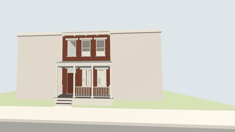

[Tour as MP4](docs/img/tour-front-to-back.mp4) · [porch options tour](docs/img/tour-porch-options.mp4)

The example house is made up: a two-story brick rowhouse with a rear wing, a front
porch and a small yard. It's close to my real house, which I modeled this way from
LiDAR scans to plan a back porch. Every dimension says where it came from
(tape, scan, spec sheet, estimate), and every option comes from a real product:

- **Cladding:** brick (paint it or not), fiber-cement lap at 7" exposure, board and
  batten at 16" o.c., cedar shingles
- **Paint:** body and trim from Sherwin-Williams chips
- **Front porch:** floor, posts and rails, haint-blue ceiling, front door, plus sliders
  for porch depth (6-8'), roof pitch (1-4 in 12) and guard height (36-42")
- **Rear sliding door:** Andersen 200 Series, Marvin Elevate, Pella Lifestyle, each at
  its published unit size, rough opening and jamb depth, in its maker's colors. Slide
  it open.
- **Existing vs proposed**, **day/overcast/dusk** with the real sun for any month and
  hour (shadows included), **floor-plan cuts**, the **scan** as a point layer over a
  ghosted model, lot lines, a compass, and save/load/PNG/GLB export
- **Construction drawings** for whatever's on screen: the slider install (elevation, jamb
  plan, head and sill) for each door, and the porch railing for each guard height and
  depth, with a cut list and a buy list. Web pages you can read on a phone, and PDFs.

| Lap siding, Sea Salt | Cedar shingles, Rosemary |
| --- | --- |
| 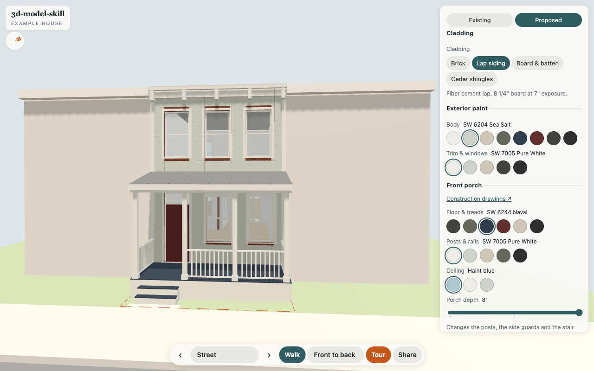 | 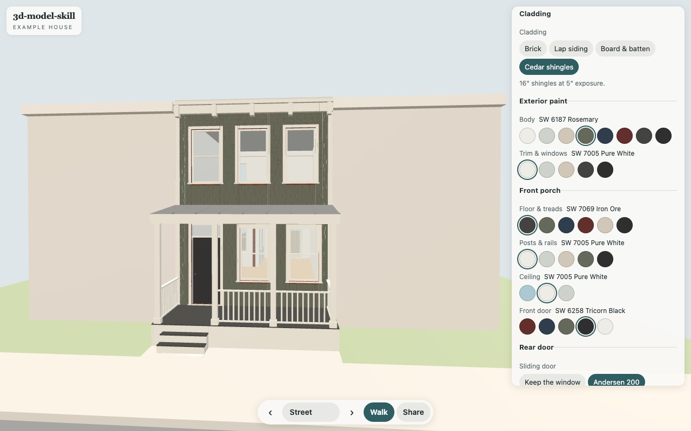 |
| **Painted brick, black trim** | **Andersen 200 Series, 60% open** |
| 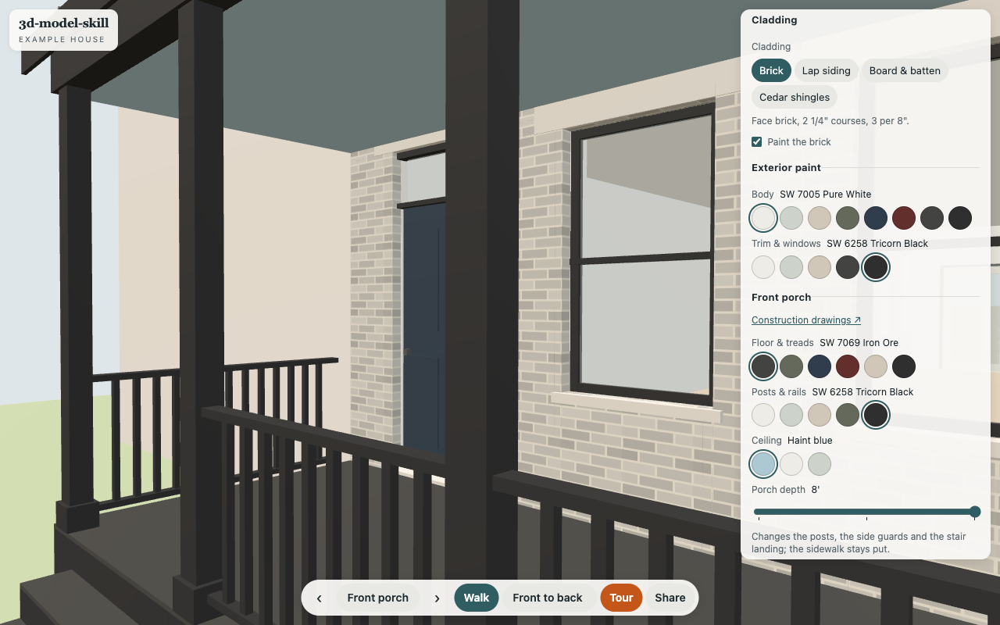 | 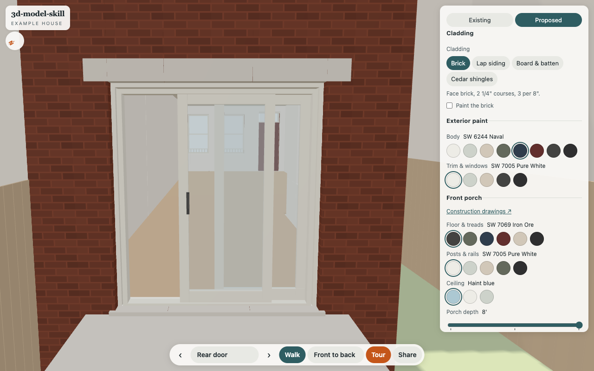 |
| **Board & batten + Marvin Elevate** | **Inside, Pella Lifestyle** |
| 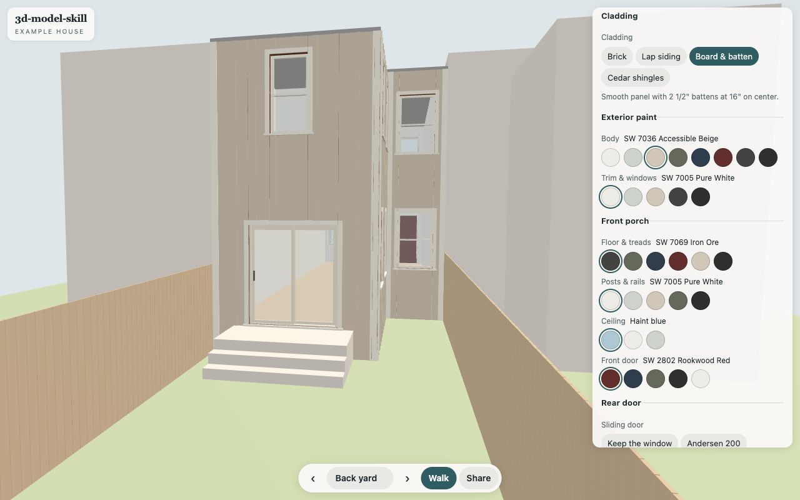 | 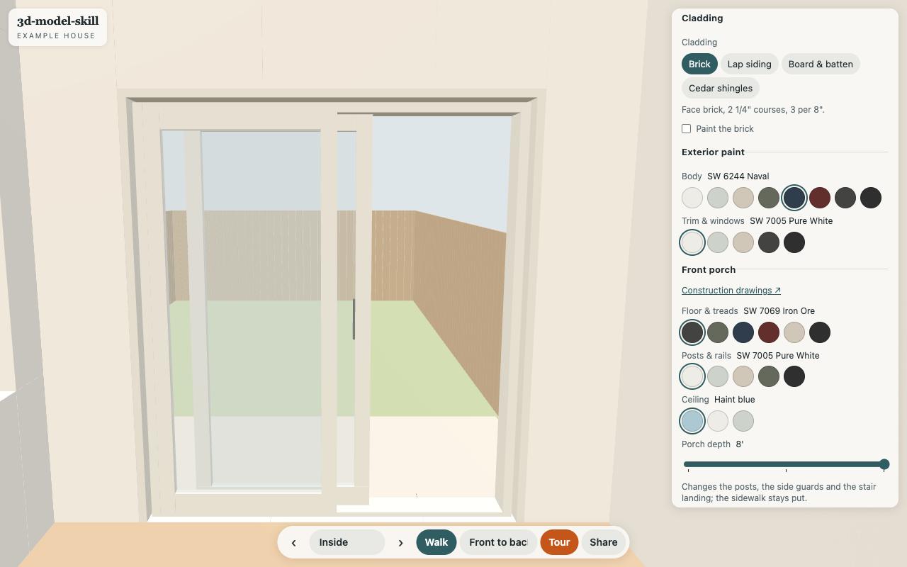 |

On a phone: a bottom sheet for the options, and Walk mode with a joystick under your
left thumb (hold it to speed up, double-tap anywhere to go there).

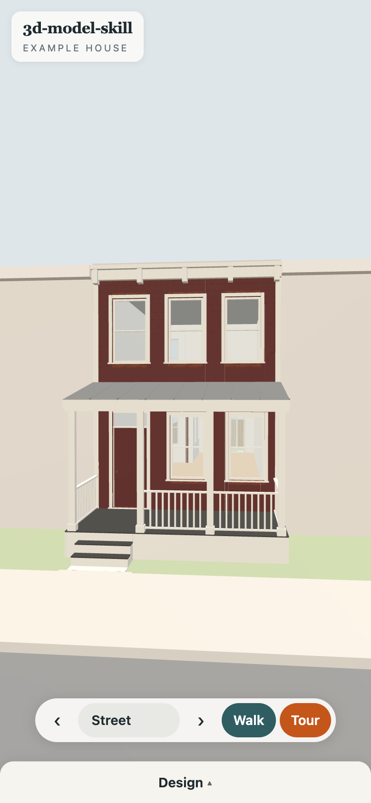 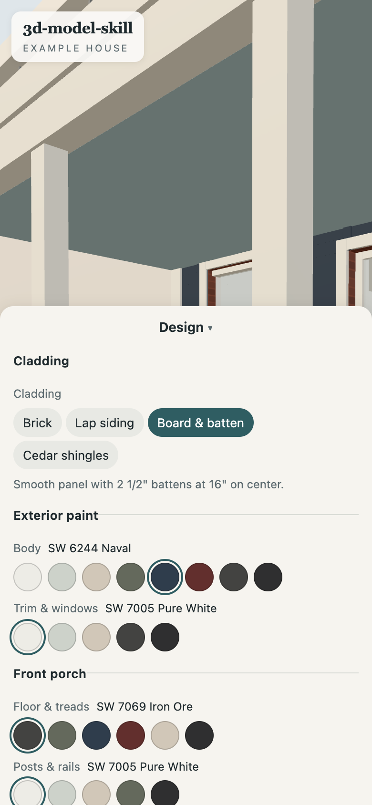

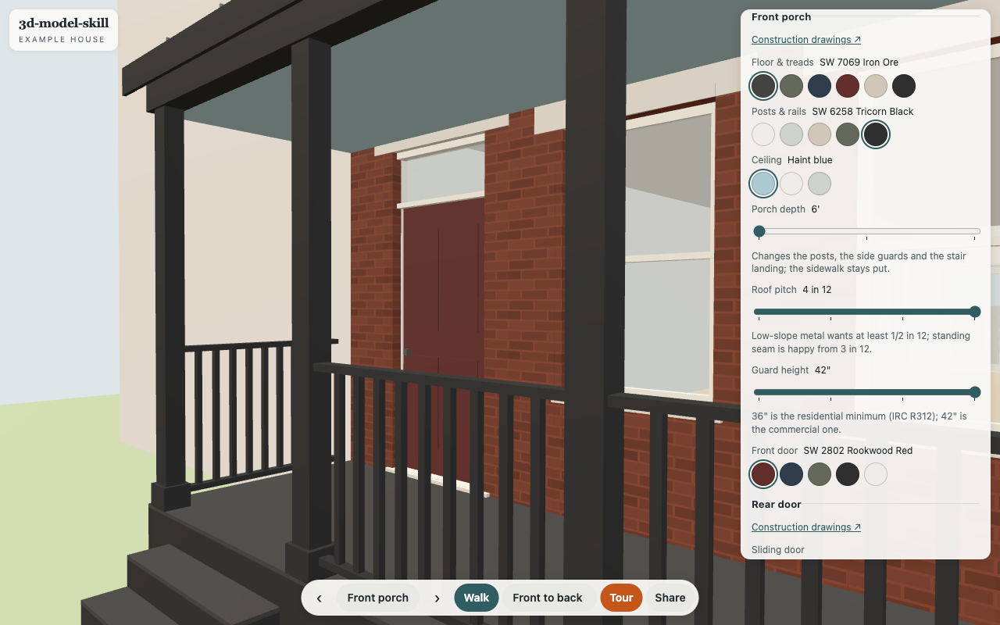

| Dusk | First floor plan cut |
| --- | --- |
| 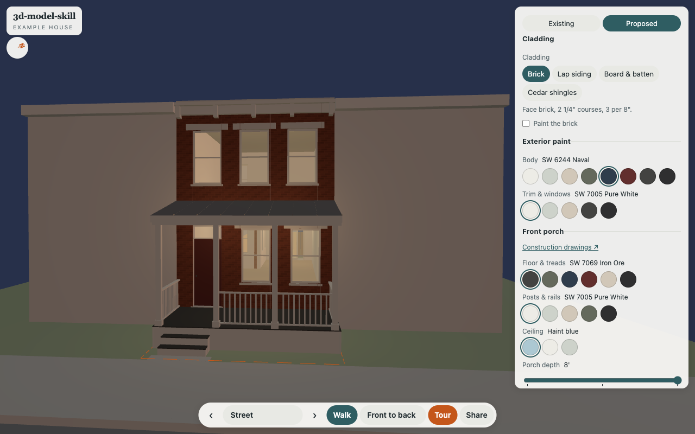 | 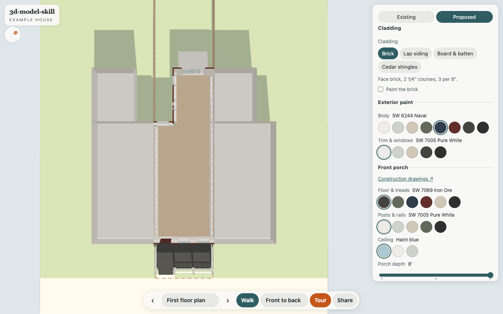 |
| **Existing (as measured)** | **Scan points, model ghosted** |
| 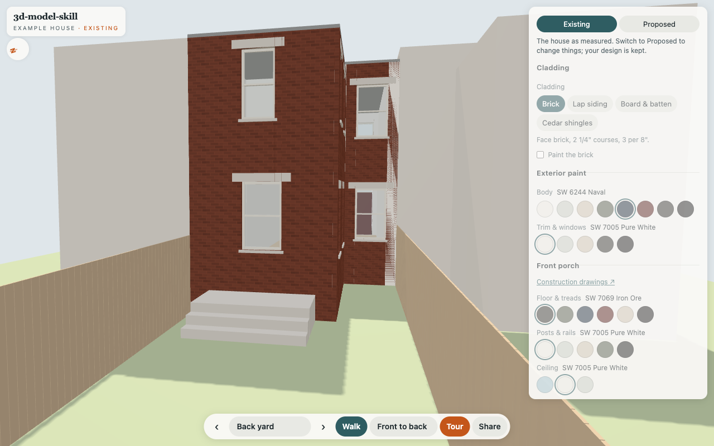 | 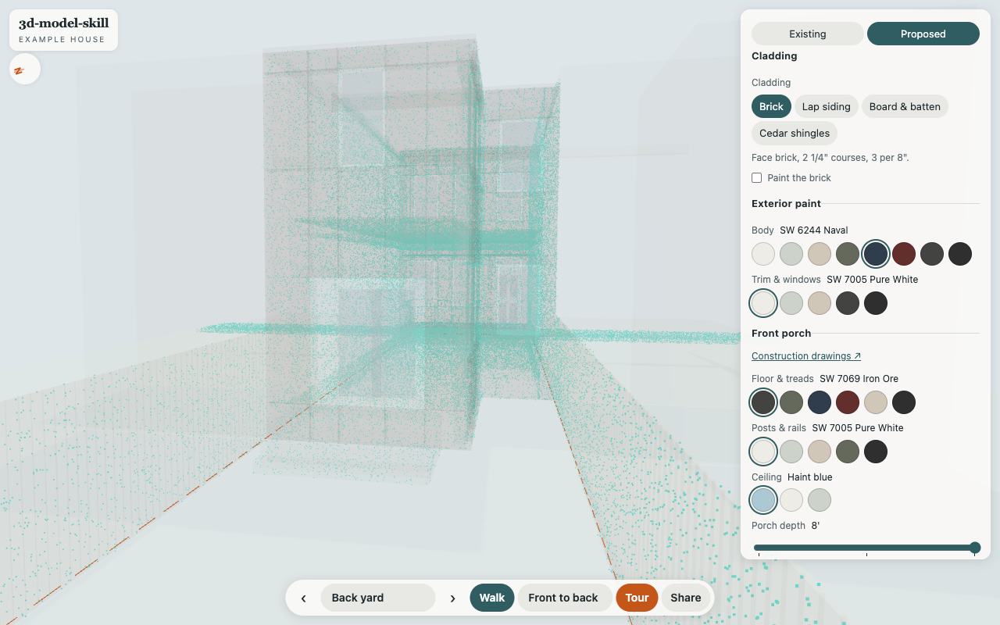 |

| Slider install, Andersen 200 | Railing, 36" guard |
| --- | --- |
| 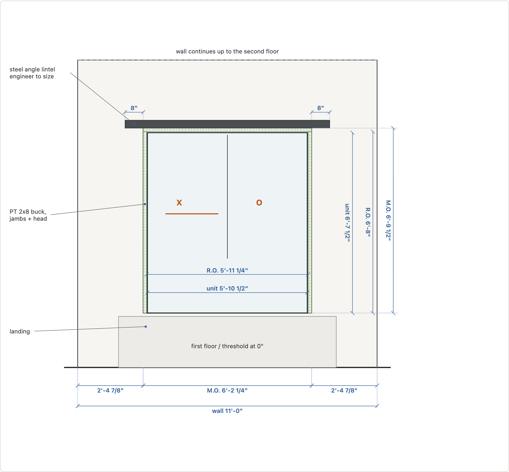 | 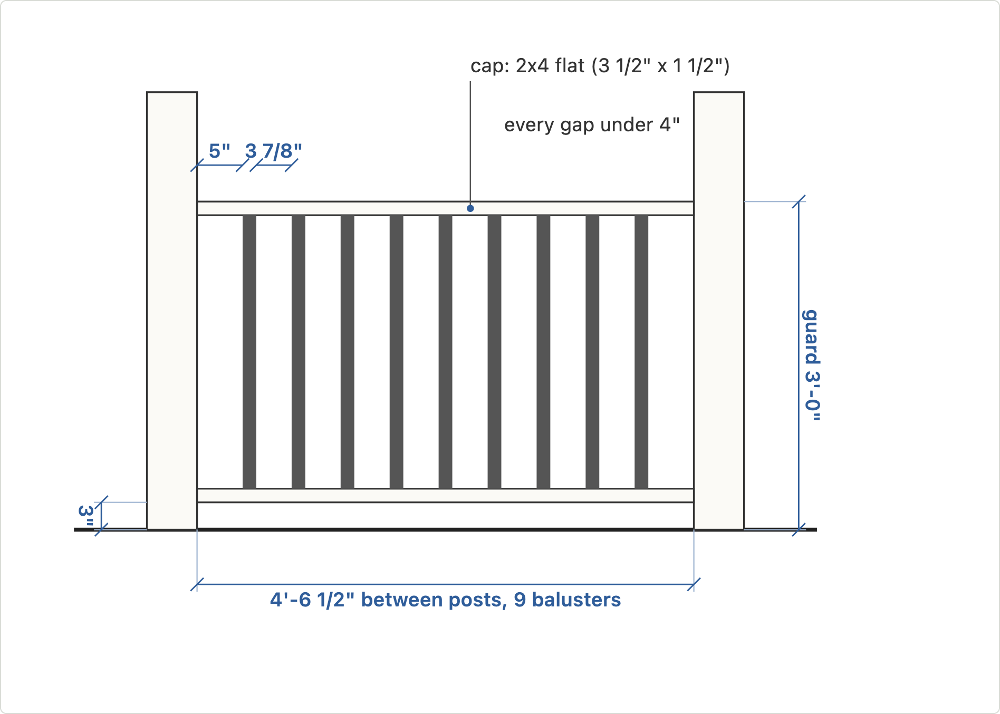 |

Browse them: https://kylefritz.github.io/3d-model-skill/drawings/

## Run it

Needs [uv](https://docs.astral.sh/uv/) and Python 3. No other installs.

```
$ make check
wrote 73 GLBs, 6.90 MB, 139248 faces
wrote 15 drawing sets to site/drawings/
ok: 73 GLBs, first load 0.41 MB, all 6.90 MB
$ make serve            # http://localhost:8000
$ make test-viewer      # drives it on an emulated iPhone
$ make check-drawings   # every label readable on a phone, then PDFs
$ make tours            # records the tours to docs/img
$ make demo-scan        # registers a fake LiDAR scan to the model
$ uv run tools/scan_sheets.py   # scan vs model plan cuts and a long section
$ uv run tools/verify_live.py https://you.github.io/3d-model-skill/   # live = built, byte for byte
```

## How it works

1. **[Capture](docs/capture.md):** scan with Scaniverse (or Polycam, 3d Scanner App),
   export the mesh *and* the points, tape one thing per scan, and register the scans to
   one origin. Also covers what's new: Gaussian splats, VGGT, MASt3R, scan-to-floor-plan.
2. **[Model](docs/model.md):** numbers in `model/house.yaml` with sources, generators in
   `model/build.py`, checks in `model/check.py`.
3. **[Parameters](docs/parameters.md):** the trick. One contract (`controls.json`) that the
   generator writes and the viewer reads. Colors recolor named materials, swaps load
   pre-built GLBs, ranges slide named nodes, steps are sliders over pre-built shapes.
   Tours are keyframed camera paths that can change options as they go.
4. **[Drawings](docs/drawings.md):** SVG sheets, a cut list and a buy list generated from
   the same layout functions as the model, checked for readability, for drawn = cut =
   bought, against cuts through the GLBs, and for anything the buy list leaves out.
   **[Viewer](docs/viewer.md):** existing/proposed, light and sun, plan cuts, evidence,
   save and share.
5. **[Publish](docs/publish.md):** GitHub Pages (this repo deploys itself) or Cloudflare
   Workers with your own domain.

## The skill

`skills/3d-model/SKILL.md` walks an agent through all of it, and asks which host you want
at the end. To use it with Claude Code:

```
$ ln -s "$PWD/skills/3d-model" ~/.claude/skills/3d-model
```

Then: "scan my kitchen and model it", "what would the house look like in board and
batten", "add a Marvin door option", "publish this".

## Credits

three.js is vendored under its MIT license. The drawing kit and its readability check
come from my Tunnel of Terror coffin drawings. Door, siding and brick numbers come from the
manufacturers' sheets linked in `model/doors.yaml` and the docs. Paint hexes are
Sherwin-Williams' own, and door frame hexes are by eye.

TODO
- splat of the real scan as an "existing" view
- meshopt in the build, for a scanned or textured house (see docs/publish.md)
