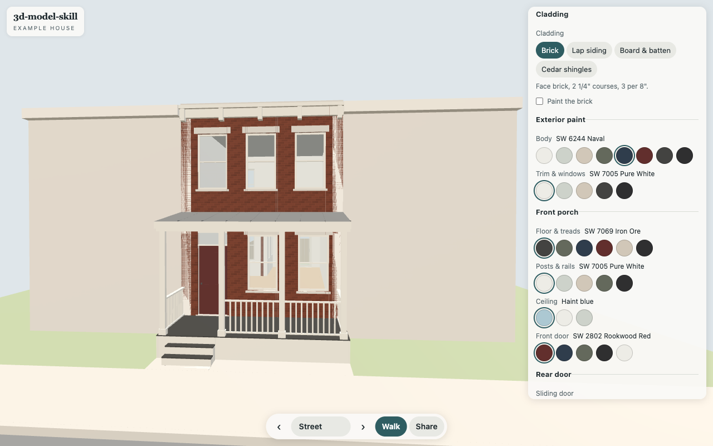

# 3d-model-skill

Scan a house with your phone, model it from real numbers, and put a parametric 3D
viewer on the web where you can try the paint, the siding and a new door.
A Claude skill plus a working example.

**Live example: https://kylefritz.github.io/3d-model-skill/**



The example house is made up: a two-story brick rowhouse with a rear wing, a front
porch and a small yard. It's close to my real house, which I modeled this way from
LiDAR scans to plan a back porch. Every dimension says where it came from
(tape, scan, spec sheet, estimate), and every option comes from a real product:

- **Cladding:** brick (paint it or not), fiber-cement lap at 7" exposure, board and
  batten at 16" o.c., cedar shingles
- **Paint:** body and trim from Sherwin-Williams chips
- **Front porch:** floor, posts and rails, haint-blue ceiling, front door
- **Rear sliding door:** Andersen 200 Series, Marvin Elevate, Pella Lifestyle, each at
  its published unit size, rough opening and jamb depth, in its maker's colors. Slide
  it open.

| Lap siding, Sea Salt | Cedar shingles, Rosemary |
| --- | --- |
|  |  |
| **Painted brick, black trim** | **Andersen 200 Series, 60% open** |
|  |  |
| **Board & batten + Marvin Elevate** | **Inside, Pella Lifestyle** |
|  |  |

On a phone: a bottom sheet for the options, and Walk mode with a joystick under your
left thumb (hold it to speed up, double-tap anywhere to go there).

 

## Run it

Needs [uv](https://docs.astral.sh/uv/) and Python 3. No other installs.

```
$ make check
wrote 25 GLBs, 4.39 MB, 90504 faces
ok: 25 GLBs, first load 0.41 MB, all 4.39 MB
$ make serve           # http://localhost:8000
$ make test-viewer     # drives it on an emulated iPhone
$ make demo-scan       # registers a fake LiDAR scan to the model
```

## How it works

1. **[Capture](docs/capture.md):** scan with Scaniverse (or Polycam, 3d Scanner App),
   export the mesh *and* the points, tape one thing per scan, and register the scans to
   one origin. Also covers what's new: Gaussian splats, VGGT, MASt3R, scan-to-floor-plan.
2. **[Model](docs/model.md):** numbers in `model/house.yaml` with sources, generators in
   `model/build.py`, checks in `model/check.py`.
3. **[Parameters](docs/parameters.md):** the trick. One contract (`controls.json`) that the
   generator writes and the viewer reads. Colors recolor named materials, swaps load
   pre-built GLBs, ranges slide named nodes.
4. **[Publish](docs/publish.md):** GitHub Pages (this repo deploys itself) or Cloudflare
   Workers with your own domain.

## The skill

`skills/3d-model/SKILL.md` walks an agent through all of it, and asks which host you want
at the end. To use it with Claude Code:

```
$ ln -s "$PWD/skills/3d-model" ~/.claude/skills/3d-model
```

Then: "scan my kitchen and model it", "what would the house look like in board and
batten", "add a Marvin door option", "publish this".

## Credits

three.js is
vendored under its MIT license. Door, siding and brick numbers come from the
manufacturers' sheets linked in `model/doors.yaml` and the docs. Paint hexes are
Sherwin-Williams' own, and door frame hexes are by eye.

TODO
- splat of the real scan as an "existing" view
- Draco compression for bigger models
- roof options
