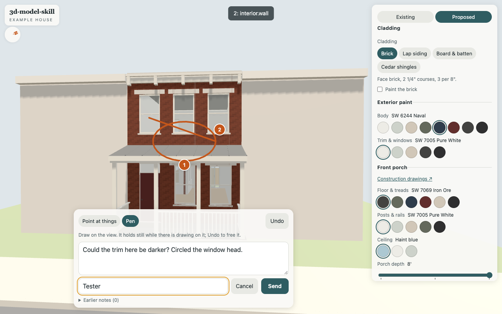
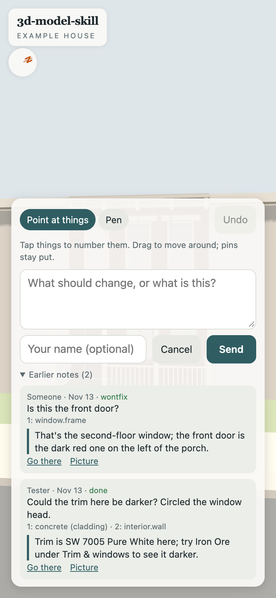

# Comments from the viewer

The viewer's **✎ Comment** button lets anyone looking at the model point at things or draw on
it, write a note and send it. An agent picks the notes up from the repo, acts on them, and
answers. The answer shows under the note in the viewer.

| Point and draw (desktop) | Earlier notes with replies (phone) |
| --- | --- |
|  |  |

It needs a server, so it works on the **Cloudflare** host only: a small Worker
(`worker/index.js`) in front of the static site, and a free D1 database. On **GitHub Pages**
(and `make serve`) there is no `/api/`, and the viewer hides the button: it asks
`GET api/comments?model=NAME` at start and shows the button only if that answers.

## In the viewer

- **Point at things**: tap the model. Each tap drops a numbered pin that keeps the 3D point
  and what it hit. If the model's pieces carry glTF extras `kp_id` and `kp_label`, the pin
  keeps those (a toast shows the label); otherwise it keeps the node's name and its slot
  (`window.frame`, `paint.trim (rear)`). Drag still orbits; pins stay put.
- **Pen**: draw on the picture. Strokes are on the screen, not in 3D, so the camera holds
  still while there is any ink. **Undo** takes back the last pin or stroke.
- A note, an optional name (remembered in this browser), **Send**. The viewer posts:

  ```json
  {"model": "example-house", "author": "", "body": "…", "show": "proposed",
   "link": "https://…/?door=marvin&view=rear&cam=…", "cam": "px,py,pz,tx,ty,tz",
   "pins": [{"x": 0, "y": 0, "z": 0, "id": "window.frame", "label": "window.frame"}],
   "strokes": 1, "image": "data:image/jpeg;base64,…", "website": ""}
  ```

  `image` is the frame as rendered, with the ink and the pins drawn on, at most 1600 px wide.
  `link` restores the design, the light, Existing/Proposed and the exact camera. `website` is
  a honeypot: a hidden field people never fill in.
- **Earlier notes** lists the model's notes, newest first, with their status and the reply.
  **Go there** puts the design and the camera back where the note was written; **Picture**
  opens what was sent.

## Set it up (Cloudflare)

```
$ npx wrangler@4 d1 create 3d-model-comments    # paste the database_id into wrangler.jsonc
$ make deploy-cloudflare                         # applies worker/migrations, then deploys
```

`model/options.yaml` has `name: example-house`. The Worker's `MODELS` set in
`worker/index.js` lists the names it takes notes for, and `make check` fails unless the two
match. Rename both together.

To publish on Cloudflare without comments, delete the `d1_databases` block. The Worker then
answers `/api/` with a 404 and the button stays hidden.

## Try it locally

```
$ make dev                                   # wrangler dev + a local D1 on :8787 (PORT=8790 to move it)
$ uv run tools/comments.py --local           # notes in the local database
```

## Pick them up

`tools/comments.py` reads and writes the database with `wrangler d1 execute --remote --json`,
so it needs this machine's wrangler login and nothing else. No token goes in the repo.

```
$ make comments                                        # open notes, one line each (ALL=1 for all)
$ uv run tools/comments.py show c_mwfw8ud57rka          # the note in full; picture -> out/comments/ID.jpg
$ uv run tools/comments.py reply c_mwfw8ud57rka "Darker trim is in: Trim & windows is now Iron Ore." --status done
```

`--status` is `done`, `wontfix` or `open`. Pins and `cam` are viewer metres (glTF, Y up); the
model frame's (x, y, z) is the viewer's (x, z, -y).

**A session opens with them.** `.claude/settings.json` has a Claude Code SessionStart hook
that runs `tools/comments.py --hook`. When notes are open, it prints them into the session's
context; when there are none, you're offline, or `wrangler.jsonc` still has the placeholder
database id, it prints nothing.

## Lessons

1. **The ink sits below the panels.** The pen's canvas covers the screen, so give it the
   lowest z-index of the overlays (`#ink` 1, pins 2, the panels 3, the toast 4). Above the
   panel, it eats the click on Send in pen mode.
2. **Keep the tool after a send.** Switching back to Point looked tidy, but in Point a drag
   orbits: someone circling the next thing orbits the house instead, and the note arrives
   without the circle.
3. **Read the picture before acting.** Pen marks exist only in the picture. A note with no
   pins and no ink gives only the camera: recreate the view at the picture's aspect and
   raycast to find what's in the middle of it.
4. **Pin the compatibility date.** `wrangler dev` runs a bundled workerd that may not support
   a very new `compatibility_date` ("requires compatibility date …, but the newest date
   supported by this server binary is …"). Use a date it supports.
5. **The endpoint is public.** Anyone can post: there's a honeypot and size caps (4,000
   characters, 40 pins, a 1.5 MB picture), not a login. If spam shows up, put
   [Turnstile](https://developers.cloudflare.com/turnstile/) on Send or
   [Cloudflare Access](https://developers.cloudflare.com/cloudflare-one/policies/access/) on
   `/api/*`; `make comments` shows it first. **Replies are public too**: keep them about the
   model, with no private detail.
6. **Whitelist the model names** on the server, and keep the list equal to what the site
   shows with a check (here, `make check`), or a renamed model quietly stops taking notes.
7. **Capture in the same task as the render.** `snapshot()` renders and reads the canvas
   in one go, so it needs no `preserveDrawingBuffer` (which costs every frame).
