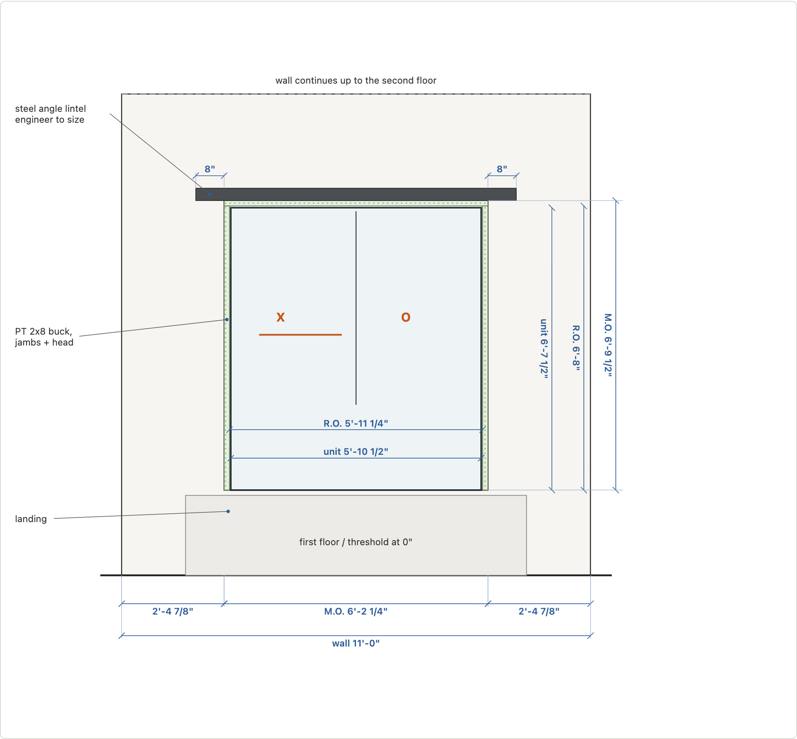

# Drawings: plans someone can build from

Once the model has the right numbers, a contractor or the person at the lumber yard wants
the same numbers on paper. The trap is a second copy: a CAD file or a hand sketch that
drifts the day the model changes. Here the drawings are generated from the same
functions that build the 3D model, every time.

```
house.yaml + doors.yaml ─┬─> build.py ──> GLBs
                         └─> build.rear_opening(), build.rail_runs(), build.baluster_layout()
                                  └─> drawings.py ──> SVG sheets + cut list + buy list ──> PDF
```

| Set | Sheets | One per |
| --- | --- | --- |
| Rear slider installation | A1 exterior elevation, A2 plan at the jamb, A3 head and sill | door option (`door-andersen200/`, `door-marvin/`, `door-pella/`) |
| Front porch railing | P1 railing elevation, P2 porch plan | guard height x porch depth step (`porch-36-8/` …) |

The viewer links each section to the set for exactly what's on screen: change the door
or drag the guard-height slider and the "Construction drawings" link changes with it.



## One set of numbers

`build.rear_opening(spec, plan, door)` returns the door's layers from the spec sheet
out: unit inside rough opening inside a PT buck inside the masonry opening, plus the
setback and lintel bearing. The 3D model cuts the brick at the masonry opening and
builds the buck from it. The drawings dimension the same four rectangles, and the cut
list buys the buck and lintel from them. Change `buck: 1 1/2"` in `house.yaml` and all
three move.

The porch works the same way: `rail_runs()` says where the guards go and
`baluster_layout()` spaces the balusters under the 4" sphere. The model, the plan, the
elevation and the baluster count on the buy list all call them.

## The register

`model/drawings.yaml` is the register: one brief per sheet saying what was asked for,
how sure the numbers are, and what's still open. The generator prints all three on the
sheet, so nobody mistakes an estimate for a measurement:

```yaml
A1:
  title: Exterior elevation
  brief: The opening as the mason sees it from the yard...
  confidence: Door sizes from the maker's sheet. Wall length from the scan (about 1"). Lintel size is an estimate.
  open: [Engineer to size both lintels; the wall carries the second floor.]
```

Add a brief before you add a sheet.

## Drawing kit

`drawings.py` has a small SVG kit, after the Tunnel of Terror coffin drawings:

- `Svg(k, x0, y0, w, h)`: k px per inch, y up, inches in.
- `dim(a, b, label, off)`: a dimension with extension lines and architectural ticks.
- `note(at, target, text)`: a callout whose leader leaves the side of the text nearest
  the target, so a leader never runs through its own words.
- Classes, not colors: `brick`, `masonry`, `pt` (pressure-treated), `steel`, `eng` (by
  engineer, dashed red), `unit`, `gap`. One stylesheet sets the look on screen and in print.
- Phone first: an SVG never shrinks below the width where 12 px labels render at 9.5 px;
  narrower screens scroll the drawing, not the page.

## Cut list and buy list

Every piece comes from the same layout calls. Boards are packed longest-first into the
stock length that wastes least, with a 1/8" kerf between cuts:

For the 36" guard on the 8' porch, the 44 balusters are 2'-6" each, so three come out
of every 8' 2x2: 15 boards. The caps and bottom rails pack two runs per 12' board.

`make check` proves the takeoff:

- every piece on the cut list is in a bought board, and nothing else is;
- no board is bought for nothing, and none is over-cut;
- balusters drawn on the plan = balusters on the cut list = balusters bought;
- the door's unit, rough opening and masonry opening widths are printed on its sheets;
- the lintel gets its bearing plus 4" of brick past it on each side.

## Drawings against the model

The takeoff checks prove the drawings agree with the layout functions. `check.py` also
cuts the exported GLBs and checks they agree with the drawings:

- each door's rear wall GLB is cut 3' up, and the hole in the brick must equal the
  masonry opening on its sheets, to 1/8";
- each porch GLB is cut 18" above the floor, and the number of 1 1/2" baluster sections
  must equal the cut list.

## Traceable takeoff

A buy list that's missing things is worse than none, because it looks complete. Each set in
`drawings.yaml` has a `coverage:` table: every material in that set's GLBs, and either
`buy` or who it belongs to ("decking and treads not taken off yet", "by the roofer").
The sheets print the non-`buy` rows under **Not on this list**. If the model grows a
material the table doesn't mention, `make check` fails.

```yaml
coverage:
  porch.trim: "buy: posts, caps, bottom rails, balusters. Not yet: beam, fascia, skirt, stair risers and stringers"
  porch.floor: decking and treads not taken off yet
  roof.metal: by the roofer
```

## Readable, or it fails

`tools/check_drawings.py` opens every set in Chromium and fails when two labels overlap,
a line crosses a label (leaders, dimension and extension lines, part outlines), a label
runs off its drawing, leaders cross each other, a label renders under 9 px on a 390 px
phone, or the page scrolls sideways. It's strict on purpose: the first run on these
sheets found 44 problems, every one of which you'd have hit on a phone at the lumber
yard. With `--pdf` it prints each set to a letter-size PDF from the same page, so the PDF
and the web page can't disagree. CI runs both before it deploys.

```
$ make serve            # in one shell
$ make check-drawings   # in another
ok   every drawing is readable
```

## Not for construction

The sheets say so at the top. Anything structural (here, both lintels in a bearing brick
wall) needs an engineer, and every dimension needs checking in the field. The point is
that what you hand the engineer and the contractor matches the model you've all been
looking at.
