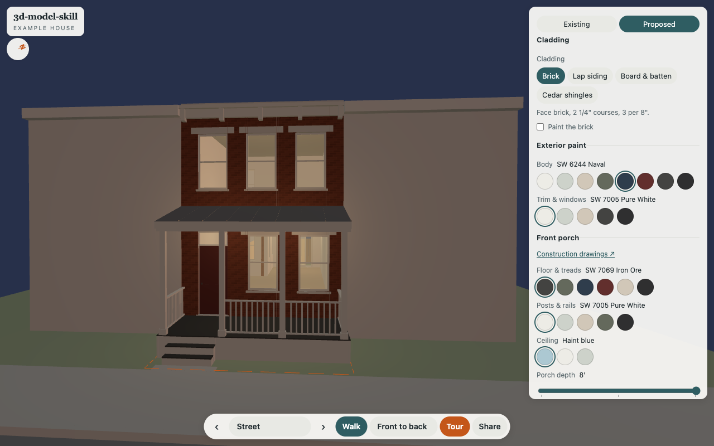
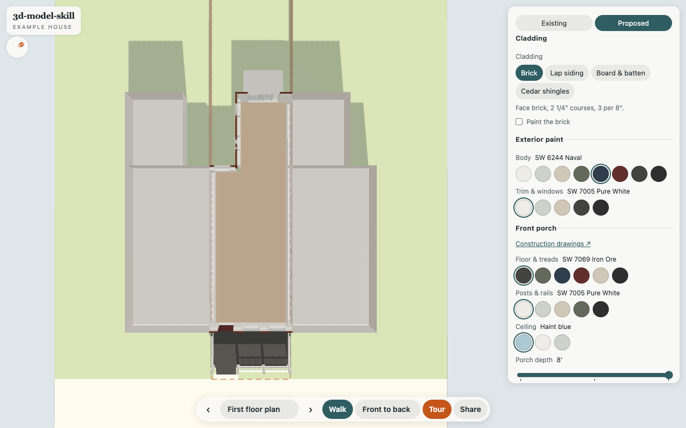
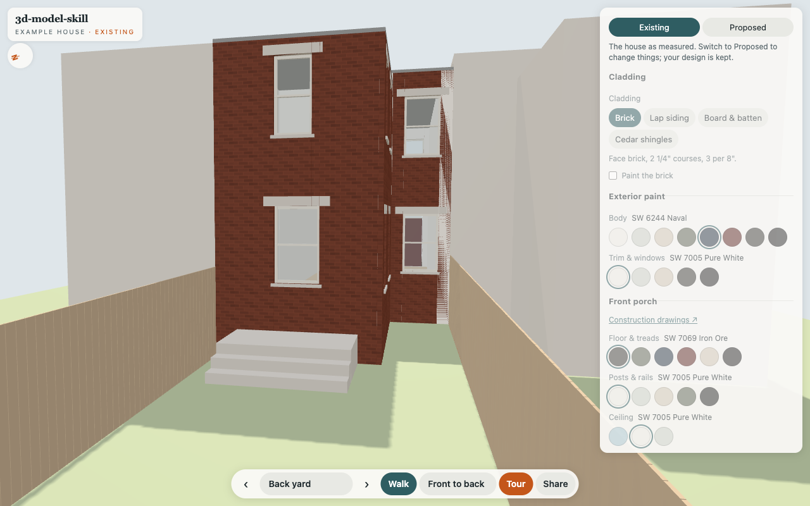
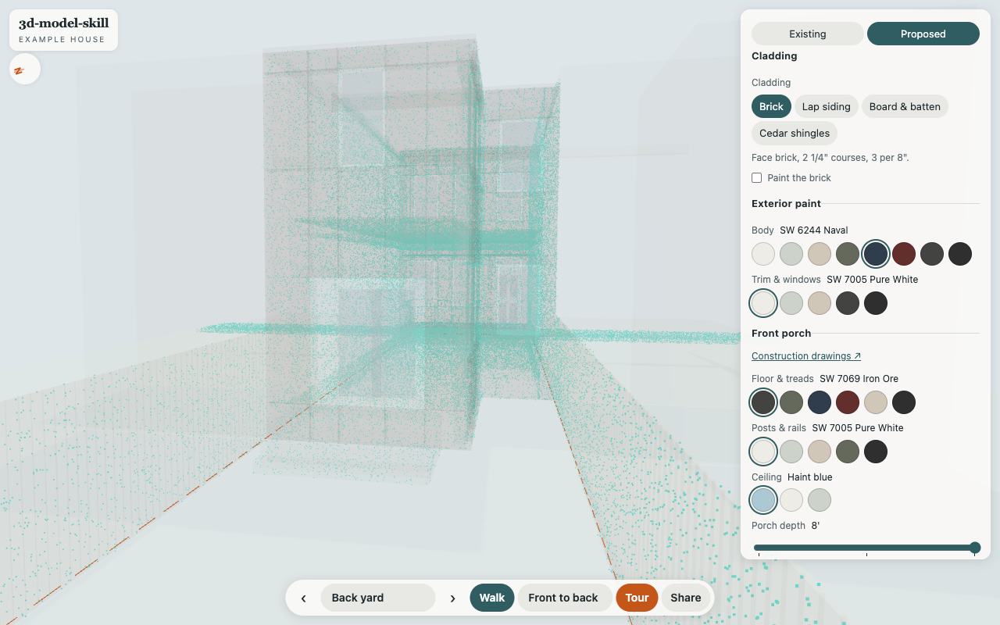

# The viewer

`site/app.js` is plain JavaScript on vendored three.js, with no build step. It reads
`controls.json` and knows nothing about houses: it recolors named materials, swaps GLBs
into slots, slides named nodes. The parts below are how you *look* at the house, so they
live in the viewer rather than in the contract's sections.

| | |
| --- | --- |
|  |  |
| **Dusk** | **First floor plan cut** |
|  |  |
| **Existing (as measured)** | **Scan points, model ghosted** |

## Existing and proposed

`options.yaml` has an `existing:` block: the house as measured today. The Existing /
Proposed switch at the top of the panel shows those values over your design without
touching it. The panel locks, and when you switch back your design is still there. The
share link keeps both (`?state=existing&door=marvin...`), so "here's what it is, here's
what it could be" is one link.

## Light

- **Day** puts the sun where it really is. The site's `anchor` (latitude and longitude),
  `y_bearing` (which way the model faces), a month and a solar hour give the sun's
  elevation and azimuth to within a degree or so. Shadows on. The hour is solar time, not
  the clock: no time zones.
- **Overcast**: flat light, no shadows, for reading color.
- **Dusk**: a dark sky, the contract's `lights` on (porch ceiling, a sconce, rooms
  inside) and the glass glowing, so windows read lit.
- **Exposure** for all three.

The compass under the title turns with the camera.

## Plan cuts

A viewpoint with `section` (cut height in inches) clips everything above it and looks
straight down, so it reads as a floor plan. The cut walls show from inside, with no caps.
Double-tap ignores what the cut removed.

```yaml
- {name: First floor plan, eye: [96, 270, 1100], target: [96, 272, 0], section: 48}
```

## Evidence and site

- **Scan points**: the registered scan as a point layer (`site/scan/points.glb`). The demo's
  is simulated, sampled off the model with 1 cm of noise. For a real one, register it
  (`tools/register_scan.py`) and export points to a GLB.
- **Ghost the model** to see the scan through it.
- **Lot lines**, dashed on the ground, from `lot_depth` and the party lines.
- **Scan vs model sheets** (`tools/scan_sheets.py`): plan cuts and a long section, scan in
  black, model in red, on a 1' grid. CI publishes them at `scan/sheets/`.

## Save and share

- **Share** copies a link with every non-default setting, the view, the light and the state.
- **Save choices (.json)** and **Load choices** move a design between browsers or people.
  Browser storage doesn't cross domains or devices; a file does.
- **Save this view (.png)** renders and captures in one go (no `preserveDrawingBuffer`).
- **Download this design (.glb)** exports what's on screen, shell plus chosen options with
  their colors, for Blender, SketchUp or anything that opens glTF.
- Keys: **1-9** jump to views, **F** for full screen (CSS, so it works on an iPhone too),
  **Esc** to leave it.

## Getting around

Orbit by default, at `rotateSpeed` 0.45 so a swipe doesn't spin the house. Double-tap flies
to a spot. Walk keeps your view, puts a joystick under the left thumb on touch screens,
speeds up while held, and double-tap goes there. The full set of rules is in the skill.

## Gotchas we hit

- **No normals, no shadows.** Without normals in the GLB, three flat-shades the faces
  correctly but skips shadows without a warning. Export normals.
- **Shadow camera bounds** need `updateProjectionMatrix()` after you set them, or the
  shadow box stays at the default 10 m and half the house gets no shadows.
- **Changing `transparent` needs `material.needsUpdate`.** three compiles an opaque shader
  variant, and opacity does nothing until it recompiles. A ghosted wall is several stacked
  faces, so keep each one very faint (8%).
- **GLTFLoader strips dots from object names** (`door.operable` → `dooroperable`).
  Match on `userData.name`.
- **Coplanar faces z-fight.** Here it showed up as plaster-white stripes in the brick, three
  times. Raycast the pixel (`window.viewer` is exposed for that), then give each wall its
  own volume.
